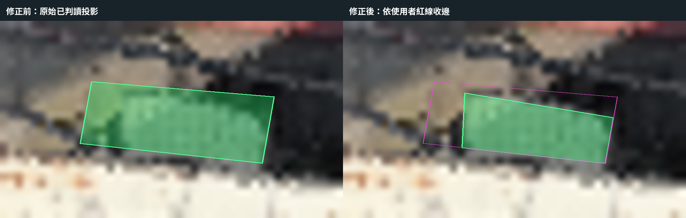

# 東寮段 804-5 紅線修正

日期：2026-10-19。版本：`20261019-804-5-redline-review-v8`。面積認定仍待複核；使用者已授權將本次修正提交並推送 Git，網站部署狀態另行確認。

依使用者於來源分層點雲上補充的紅線，收進左側與斜上緣；未移動原始地籍或三維模型。來源圖為根工作目錄 `.local/1015-review/46F-model.png`，像素依 `inventory.json` 的影像範圍映射至 TWD97。

| 項目 | 修正前 | 修正後 |
|---|---:|---:|
| 已判讀水平投影面積 | 0.5151484 m² | 0.3213017 m² |
| 登記面積 | 9.84 m² | 9.84 m² |
| 占登記面積比例 | 5.23525% | 3.26526% |

紅線對應來源影像像素：`[[211,234.5],[230.5,237.75],[229,246],[210.5,244.458333333]]`。新計量輪廓為此範圍與原已判讀投影及既有地籍的交集，未將原來沒有計量的地方加入。選區內來源高度 163.8–167.8 m 共有 4,919 個模型支持點。

綠色顯示改用現有 `ClassificationPrimitive` 在實際模型表面著色，來源高度限 164.2–166.1 m，仍經模型地面錨點校準高程。分類體僅作著色遮罩，不繪製其矩形頂面或側牆。未支援模型分類時仍沿用既有備援機制。

本次更新：

- `viewer-source/public/overlays/taoyuan-1015/dongliao-1015-02.geojson` 與對應發布檔。
- `viewer-source/src/taoyuan1015Parcels.json` 中 804-5 的數值、版本與說明，並同步既有打包檔的該筆資訊。
- 生成設定、804-5 稽核項目及兩份複核圖。
- `scripts/review_taoyuan_804_5.py` 保存局部修正方法，可用本機既有點雲與套件重現；不需要在來源 CAD 缺席時重造 CAD。

檢查涵蓋幾何有效、未外擴、面積一致、其他七筆目錄與稽核資料不變、地籍特徵不變、來源與發布檔一致及 JavaScript 語法。前後對照圖是來源影像上的水平輪廓比較，不是登入後的三維畫面截圖；三維場景各角度仍需觀看複核。

原檔備份與對照圖位於根工作目錄 `.local/1015-review/before-804-5-v8/`、`.local/1015-review/804-5-before-after-v8.png`。本次未推送 Git、部署 Worker 或更新私人 R2。

## Git 發布

使用者在檢視修正結果後授權上傳 Git。本次提交一併更新桃園入口及檢視器快取版本，避免沿用舊數值；不部署 Worker、不重新上傳模型。上述「未推送」與 JSON 的 `published=false` 記錄的是產製完成時狀態。

